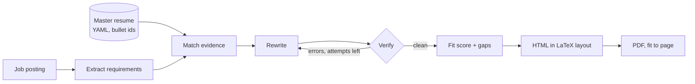

# Job Copilot

One place for the whole job search: **find** roles (LinkedIn search or any posting URL), **track** every application from "saved" to "offer", and **tailor** a resume for each job **without inventing anything**, rendered in the exact layout of my LaTeX resume.

> This repo started as an n8n workflow plus a LinkedIn scraping API. The scraper lives on inside the app (`app/sources/linkedin.py`); the original files are in `legacy/`.

## What it does

| | |
| --- | --- |
| **Find** | Search LinkedIn by keywords, location and recency (signed in with your own session cookie), or add any posting by URL: LinkedIn, Greenhouse, Lever, Ashby, or a page with JSON-LD. |
| **Track** | Status pipeline (new → saved → applied → screen → interviewing → offer, or closed), applied and follow-up dates, contact, notes, full history. A dashboard shows applications this week against a target, response rate and follow-ups due. |
| **Tailor** | Extracts the job's requirements, maps them to evidence in your master resume, rewrites and reorders bullets, then **verifies** the draft: invented numbers, skills or posting keywords are rejected and sent back for another draft. |
| **Render** | HTML that reproduces the LaTeX template (Latin Modern fonts, same sizes and spacing), editable in the browser, printed to PDF by Gotenberg, trimmed to fit the page limit. |

## How tailoring works



The model only writes structured JSON; every tailored bullet cites the master bullets it came from. Then:

| Check | Catches |
| --- | --- |
| `unknown_source`, `wrong_section_source` | Bullets that don't trace to a real bullet in the same role |
| `invented_number` | Figures not present in the cited source bullets (35% → 50%) |
| `invented_skill` | Skills you never listed |
| `keyword_stuffing` | Posting keywords that appear in the output but nowhere in your master resume |
| `judge_unsupported` | Semantic drift found by an LLM judge: scope inflation, "led" for "contributed" |

## Quick start

```bash
cp .env.example .env            # fill in Azure OpenAI + LINKEDIN_LI_AT
docker compose up --build       # API + UI on http://localhost:8000, Gotenberg for PDFs
```

**Offline demo, no Azure or LinkedIn needed:**

```bash
python -m venv .venv && source .venv/bin/activate
pip install -r requirements-dev.txt
LLM_PROVIDER=fake PDF_ENGINE=weasyprint uvicorn app.main:app --reload
```

Tests: `pytest` (48 tests; LLM and LinkedIn are faked).

## Setup notes

**Azure OpenAI (Microsoft Foundry).** Create a project at [ai.azure.com](https://ai.azure.com), deploy a model with structured outputs (e.g. `gpt-4.1-mini`), and set `AZURE_OPENAI_ENDPOINT` and `AZURE_OPENAI_DEPLOYMENT`. Leave `AZURE_OPENAI_API_KEY` empty to sign in with `az login` (give yourself *Cognitive Services OpenAI User*), or set a key.

**LinkedIn.** Set `LINKEDIN_LI_AT` to the `li_at` cookie from a browser where you're logged in (DevTools → Application → Cookies → linkedin.com). Email and password work as a fallback but trigger security checks more often. This automates your own account, which LinkedIn's terms don't permit, so keep volumes low; the app uses one browser at a time with human-ish pauses. Selectors live in pure `parse_*` functions with tests, so when LinkedIn changes its markup, the fix is small.

**Your resume.** `data/master_resume.yaml` is the source of truth. Add *more* than fits on a page (`in_base: false` keeps a bullet off your base resume but available to the tailor). `**bold**` works inside bullets. The `layout:` block controls section order, summary/headline, per-role skills lines and page limit; the defaults reproduce the LaTeX template. Preview it as-is at `/api/v1/master/preview`.

**Fonts and icons** are embedded in every HTML file, so it looks the same in any browser and in Gotenberg. Regenerate with `scripts/build_assets.py` (Latin Modern: GUST Font License; Font Awesome Free icons: CC BY 4.0).

## API

| Method | Path | |
| --- | --- | --- |
| `GET` | `/api/v1/jobs` | List, filter by status, search, follow-ups due |
| `POST` | `/api/v1/jobs` | Add by URL (LinkedIn uses your session) or pasted text |
| `PATCH` | `/api/v1/jobs/{id}` | Status, dates, contact, notes (status changes are logged) |
| `POST` | `/api/v1/jobs/search/linkedin` | Search LinkedIn and add new results |
| `POST` | `/api/v1/jobs/{id}/refresh` | Read a posting's description |
| `POST` | `/api/v1/jobs/{id}/tailor` | Tailor, verify, render; stores the result on the job |
| `GET`/`PUT` | `/api/v1/jobs/{id}/resume` | Tailored HTML; save your edits |
| `GET` | `/api/v1/jobs/{id}/resume.pdf` | PDF of the (edited) resume |
| `GET` | `/api/v1/stats` | Weekly applications, response rate, follow-ups due |
| `POST` | `/api/v1/linkedin/people` | People at a company, for referrals |
| `POST` | `/api/v1/tailor` | One-off tailoring without tracking |

Interactive docs at `/docs`.

## Layout

```
app/
  main.py            FastAPI app, quick-tailor routes, logging with request ids
  tracker.py         Jobs, statuses, history, stats, per-job tailoring
  db.py              SQLAlchemy models (SQLite by default, Postgres-ready)
  pipeline.py        LangGraph: extract → match → rewrite → verify (→ rewrite)
  faithfulness.py    Deterministic fabrication checks
  fit.py             Fit score and keyword coverage
  llm.py, prompts.py Azure OpenAI with structured outputs; prompts
  render.py          Jinja → HTML → PDF, fit to page
  sources/linkedin.py  Selenium session, search, job pages, people
  jobfetch.py, intake.py  Fetch postings from public sites safely
  templates/         Resume template + embedded fonts and icons
  static/index.html  The UI
data/master_resume.yaml
legacy/              The original n8n-era API and scripts
```

## Roadmap

- [x] Tailoring with fabrication checks, LaTeX-faithful layout
- [x] Tracker, LinkedIn search and import
- [ ] Outreach: referral and follow-up message drafts from the evidence map
- [ ] Mock interviews per job: questions from the posting and your resume, scored answers
- [ ] Deploy to Azure Container Apps with Postgres, Key Vault and managed identity; sign-in for other users
- [ ] Eval set in CI: known fabrications must be caught, fit scores must not drift
